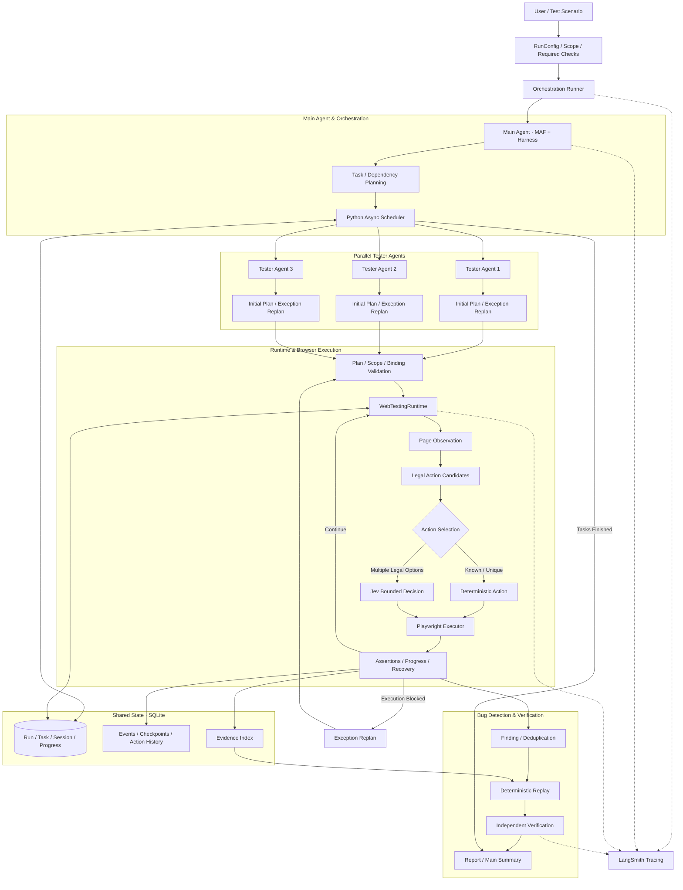

# AgentWebTest

**多智能体网页自动测试系统（Multi-Agent Web Testing System）**

基于 **Microsoft Agent Framework（MAF）、Harness、Jev Decision Model 与 Playwright** 构建的多智能体网页自动测试系统，实现任务规划、并行浏览器测试、异常恢复、Bug 复现验证及评测驱动优化。

## 项目简介

AgentWebTest 面向真实网页业务流程测试场景。用户提供测试目标、账号引用、操作范围及预期行为后，系统通过 Main Agent 与多个 Tester Agent 协作完成自动化测试。

- **Main Agent**：负责拆分测试任务、规划依赖关系、协调多个 Tester，并汇总最终结果。
- **Tester Agent**：负责制定完整测试计划，在执行异常时针对未完成任务重新规划。
- **Runtime + Jev + Playwright**：负责页面状态管理、受限动作决策、浏览器执行及异常恢复。
- **Shared State**：通过 SQLite 保存任务进度、页面状态摘要、执行记录与测试结果，支持多 Agent 跨会话协作。

系统采用 **Plan → Execute → Observe → Recover → Verify** 的执行流程。正常执行期间不反复调用 Tester Agent 规划每一步，而是由确定性 Runtime 与 Jev 完成连续决策，降低不必要的 LLM 调用。

项目实现了独立的网页测试 Demo，包含可控的业务缺陷和 Ground Truth，支持从发现异常到自动复现、验证及生成报告的完整流程。

## 核心成果

基于正式 Development Benchmark v2 的历史结果：

| 评估指标 | Baseline → Final Development |
|---|---|
| 任务成功率（Task Success） | **21.43% → 86.67%** |
| 端到端成功率（E2E Success） | **10% → 80%** |
| 检查完成率（Check Completion） | **25.68% → 78.38%** |
| Bug Precision / Recall | **100% / 100%** |
| 重规划上限停止次数 | **11 → 0** |
| 总 Token 消耗 | **降低约 41%** |
| False Positive | **2 → 0** |

独立 Holdout 评测中，Bug Precision 为 **100%**，稳定复现率为 **83.33%**。

> 以上为不同阶段的历史评测结果，并非当前代码在同一数据集上的统一验收。Final Development 的 Check Completion 未达到预设的 90% 目标。Holdout 的 Task Success 为 66.67%，E2E Success 为 37.50%，说明系统在未见场景下仍存在稳定性和泛化问题。完整结果见 [Benchmark History](evaluation/benchmark_history.md)。

## 系统架构



**核心设计原则：LLM 负责规划与必要的语义决策，确定性程序负责执行约束、状态管理、权限检查与结果验证。**

Main Agent 负责规划任务，但实际并行调度由 Python Scheduler 完成。每个 Tester 使用独立的浏览器会话，默认最多同时执行 3 个 Tester，可配置并发数量。

Jev 只在 Runtime 已生成的合法候选动作中选择，不负责完整测试规划；已知或唯一合法动作直接由程序执行。

详细设计见 [Architecture](docs/architecture.md)。

## 核心技术实现

### 1. Multi-Agent 并行协作

基于 **Microsoft Agent Framework 与 Harness** 构建 Main Agent 和 Tester Agent 协作架构。

- Main Agent 根据测试目标、Required Checks 和依赖关系生成任务计划。
- Python Async Scheduler 动态分配已满足依赖条件的任务，并持续填补空闲执行槽位。
- 多个 Tester Agent 在独立 BrowserContext 中并行测试，避免浏览器状态相互干扰。
- 使用 SQLite Shared State 保存任务状态、执行进度、Checkpoint 和跨会话协作信息。
- 通过 Progress Signal 协调有依赖关系的测试操作，支持多个用户身份之间的业务验证。

例如，测试成员权限撤销时：

1. Member 保持已登录状态。
2. Admin 在另一个独立会话中撤销权限。
3. Member 在原会话中验证访问是否被正确阻止。

系统通过 Shared State 协调两条执行链路，而不是简单地将所有任务串行运行。

### 2. Tester Agent 决策与执行优化

采用 **Tester Plan / Exception Replan + Jev Decision Model + Playwright** 的分层执行设计。

**Tester Agent**

- 初始阶段生成完整 Test Plan。
- 执行失败或无法继续时，只针对剩余任务执行 Exception Replan。
- 不参与正常浏览器操作的每一步决策。

**Runtime**

- 验证计划、输入引用、对象绑定及操作范围。
- 根据当前页面状态生成合法动作候选。
- 优先确定性执行已知或唯一合法动作。
- 管理执行预算、页面恢复和异常反馈。

**Jev Decision Model**

- 仅在多个合法候选之间进行受限选择（Bounded Decision）。
- 不修改测试目标、权限范围或完整执行计划。
- 低置信度或无法确定动作时拒绝盲目执行。

**Playwright**

- 在真实 Chromium 浏览器中执行导航、选择、填表、提交及断言。
- 记录实际操作、页面结果和错误信息。
- 通过页面锁控制同一会话的操作顺序。

该设计将高频、确定性浏览器步骤从 Agent 规划链路中分离。历史 Development 评测中，总 Token 消耗由约 129.6 万降低至约 77 万，降幅约 **41%**。

### 3. Shared State 与可靠执行

使用 **SQLite StateStore** 管理多 Agent 的任务进度和共享执行状态。

主要实现：

- **Task Dependency**：确保任务在必要前置条件完成后再执行。
- **Session Isolation**：为不同 Tester 保留独立浏览器上下文。
- **Object Binding**：绑定实际观察到的业务对象，避免操作同名但不同的记录。
- **Progress Synchronization**：在跨身份或跨会话测试中传递进度信号。
- **Bounded Recovery**：对页面刷新、控件变化及暂时不可见状态执行有限恢复。
- **Execution Budget**：限制运行时长、操作步数和重新规划次数。

涉及输入、提交或删除等操作时，Runtime 会重新验证当前页面状态及对象范围，防止使用过期候选或错误目标执行操作。

账号密码通过环境变量引用传递，执行历史不直接保存原始密码。

### 4. Bug 发现、复现与验证

系统实现了 **Finding → Replay → Verification → Report** 的自动化缺陷处理流程。

- **Finding**：将失败断言与 Check ID、浏览器操作及 Evidence 关联，并对重复发现进行去重。
- **Replay**：根据真实操作历史恢复必要前置步骤，在新的浏览器会话中重新执行。
- **Verification**：独立验证异常是否能够稳定复现，并区分已确认缺陷、已关闭缺陷和证据不足。
- **Report**：生成包含测试结果、执行证据、缺陷状态及模型用量的结构化报告。

默认复现策略要求最多 3 次尝试中至少 2 次匹配，才认定为稳定复现。

测试过程结束后再执行复现，避免重置 Demo 环境影响其他仍在运行的 Tester。

### 5. Evaluation 与性能优化

构建基于 **Ground Truth、LangSmith Tracing 和确定性评分** 的评测与优化流程。

评估覆盖：

| 维度 | 评估内容 |
|---|---|
| Task Success | 测试任务是否按要求完成 |
| Check Completion | 必要检查项是否完成 |
| E2E Success | 完整场景是否成功结束 |
| Bug Detection | Precision、Recall、False Positive |
| Reproduction | 缺陷是否能够稳定复现 |
| Efficiency | LLM Calls、Token、Cost、Runtime |
| Reliability | 异常恢复、状态同步、错误停止原因 |

**评测流程：**

1. 定义 Test Scenario、Required Checks 与 Ground Truth。
2. 运行 Baseline，记录初始表现。
3. 使用 LangSmith Trace 和执行证据定位失败原因。
4. 分别优化 Main、Tester 和 Runtime。
5. 通过本地测试及正式 Development 评测验证效果。
6. 使用独立 Holdout 检查未见场景下的表现。

系统区分检查完成与业务断言成功；检测出真实 Bug 不等同于测试任务失败。

Ground Truth 在执行过程中不暴露给 Agent，待测试运行结束后再用于缺陷匹配与评分。

详细记录见 [Benchmark History](evaluation/benchmark_history.md) 和 [Optimization Records](evaluation/optimization/)。

## Evaluation Results

正式评测包括 **10 个 Development 场景（74 个检查项）** 和 **8 个 Holdout 场景（66 个检查项）**。

| 指标 | Baseline v2 | Final Development | Final Holdout |
|---|---|---|---|
| Task Success | 21.43% | **86.67%** | 66.67% |
| Check Completion | 25.68% | 78.38% | 80.30% |
| E2E Success | 10.00% | **80.00%** | 37.50% |
| Bug Precision | 66.67% | **100.00%** | **100.00%** |
| Bug Recall | 33.33% | **100.00%** | 66.67% |
| Reproduction Success | 100.00% | 100.00% | 83.33% |
| False Positive | 2 | **0** | **0** |
| Total Tokens | 1,296,408 | **769,976** | 732,985 |

> Development 与 Holdout 使用不同测试集及不同代码阶段，不能将两者的成功率直接作为同一版本的提升幅度。Token 降低约 41% 指 Baseline 至 Final Development 的总消耗变化，并不代表请求成本同步降低。历史总费用及 Wall-clock Time 实际有所上升。

### Demo Bug Cases

项目内置 6 类可控缺陷，用于验证自动检测、证据收集及复现能力。

| Bug | 测试场景 |
|---|---|
| B1 | 已删除任务重新出现 |
| B2 | 成员能够删除其他用户的项目 |
| B3 | 允许创建空名称项目 |
| B4 | 保存后页面显示旧数据 |
| B5 | 重复提交导致重复记录 |
| B6 | 成员权限撤销后原会话仍可访问 |

Demo 通过独立缺陷开关控制不同场景，Ground Truth 由测试环境提供，但仅允许在运行结束后读取。

### 当前评测限制

Final Development 中 Task Success、E2E Success 和 Bug 检测取得明显改善，但 Check Completion 为 78.38%，未达到预设的 90% 目标。

随后针对对象绑定、填表候选和断言契约进行了局部修复，完成本地测试验证。Final Holdout 仍存在超时、无效动作、控件定位及报告总结失败等情况。

因此，本项目展示的是经过真实评测与持续优化的工程实现，**不宣称所有场景均已稳定通过，也不将 Development 的成功率视为生产环境保证**。

完整指标和失败分析见：

- [Benchmark History](evaluation/benchmark_history.md)
- [Final Readiness & Holdout Summary](evaluation/optimization/final_readiness_summary.md)

## 技术栈

| 分类 | 技术 |
|---|---|
| Multi-Agent Framework | Microsoft Agent Framework（MAF）、Harness |
| Agent Decision | Jev Decision Model、Structured Planning |
| Browser Automation | Playwright、Chromium |
| Orchestration | Python AsyncIO、Task Scheduler |
| Shared State | SQLite |
| Model Integration | OpenRouter |
| Observability | LangSmith Tracing |
| Evaluation | Ground Truth、Regression Testing、Bug Replay |
| Testing & Quality | Pytest、Ruff、mypy |
| Language | Python 3.13 |

## 项目结构

```text
AgentWebTest/
├── src/web_testing_system/
│   ├── agents/             # Main Agent、Tester Agent
│   ├── orchestration/      # Runner、Scheduler
│   ├── runtime/            # Runtime、Jev、Playwright、权限与预算
│   ├── state/              # SQLite Shared State
│   ├── evidence/           # 测试证据管理
│   ├── findings/           # Finding 收集与去重
│   ├── reproduction/       # Bug Replay
│   ├── verification/       # 独立缺陷验证
│   ├── reporting/          # 结构化报告
│   └── evaluation/         # 检查评分与指标计算
├── demo_app/               # 本地网页测试环境与 B1–B6 缺陷
├── evaluation/             # Ground Truth、Benchmark、优化历史
├── examples/               # 普通测试配置
├── tests/                  # Unit、Integration、Browser Tests
├── docs/                   # 系统架构与数据流
├── .env.example            # 环境变量模板
└── pyproject.toml
```

## 快速开始

**环境要求：** Python 3.13、Playwright Chromium，以及用于真实 Agent 运行的 OpenRouter API Key。

以下命令在 Windows PowerShell 中从项目根目录执行。

### 1. 安装依赖

```powershell
py -3.13 -m venv .venv
.\.venv\Scripts\python.exe -m pip install -e ".[dev]"
.\.venv\Scripts\python.exe -m playwright install chromium
Copy-Item .env.example .env
```

在 `.env` 中配置 `OPENROUTER_API_KEY`。如需启用 LangSmith Tracing，再配置 `LANGSMITH_API_KEY`。

模型及其他配置参考 [.env.example](.env.example)。

### 2. 启动 Demo

```powershell
.\.venv\Scripts\python.exe -m demo_app
```

浏览器访问：

http://127.0.0.1:8000

Demo 提供本地网页业务场景，可用于测试登录、项目、任务和成员管理等操作。

### 3. 运行 Agent 测试

另开一个 PowerShell 终端，执行：

```powershell
$env:DEMO_ADMIN_PASSWORD = "demo-admin"
.\.venv\Scripts\python.exe -m web_testing_system examples/demo_run.json
```

该示例使用 Admin 身份登录，检查预设项目是否正确显示，不执行创建、修改或删除操作。

真实 Agent 测试会调用配置的模型服务，并产生相应 Token 费用。

运行结果默认保存在：

```text
artifacts/runs/<run_id>/
├── report.json       # 确定性测试报告
└── summary.md        # Main Agent 总结
```

Shared State 默认保存在 `artifacts/state/shared_state.db`。`artifacts/` 不提交到 GitHub。

### 4. 运行本地测试

```powershell
.\.venv\Scripts\python.exe -m pytest
```

项目还提供静态检查：

```powershell
.\.venv\Scripts\python.exe -m ruff check src tests demo_app evaluation/measure.py
.\.venv\Scripts\python.exe -m mypy src/web_testing_system evaluation/measure.py
```

本地测试使用 Fake / Mock Provider、临时 SQLite 和本地 Chromium，不等同于调用真实模型的正式 Evaluation。

### 5. 正式 Evaluation

真实 Evaluation 入口为：

```powershell
.\.venv\Scripts\python.exe -m evaluation.measure development artifacts/runs/development-new
```

独立 Holdout 入口为：

```powershell
.\.venv\Scripts\python.exe -m evaluation.measure holdout artifacts/runs/holdout-new
```

正式评测需要模型凭据及 LangSmith Tracing 配置，可能产生费用，并写入新的运行结果目录。

建议先阅读 [Benchmark History](evaluation/benchmark_history.md)，不要为了验证安装是否成功而重复运行完整 Benchmark。

## 项目文档

- [系统架构与数据流](docs/architecture.md)
- [Demo 运行配置](examples/demo_run.json)
- [Development 测试场景](evaluation/scenarios.json)
- [Ground Truth](evaluation/ground_truth.json)
- [Holdout 设计](evaluation/holdout_v2.md)
- [Benchmark History](evaluation/benchmark_history.md)
- [Main Agent 优化](evaluation/optimization/main_optimization.md)
- [Tester Agent 优化](evaluation/optimization/tester_optimization.md)
- [Runtime 优化](evaluation/optimization/runtime_optimization.md)
- [最终评测与限制](evaluation/optimization/final_readiness_summary.md)

## 已知限制

- 当前主要针对仓库内的 Demo 网页进行正式评测，尚未证明能够稳定适用于任意真实网站。
- Development 与 Holdout 规模有限，结果不能直接代表生产环境表现。
- Runtime 仍可能受到页面结构、对象绑定、断言契约及执行预算限制。
- 真实模型调用可能受到 Provider 延迟、费用和可用性影响。
- Computer Use 视觉执行组件为可选功能，默认关闭；主要执行路径仍以 Playwright 为基础。
- 历史原始运行报告及 Trace 的部分内容保存在本地或 LangSmith，不随 GitHub 仓库提供；公开仓库保留 Benchmark 汇总、评测定义及优化记录。
